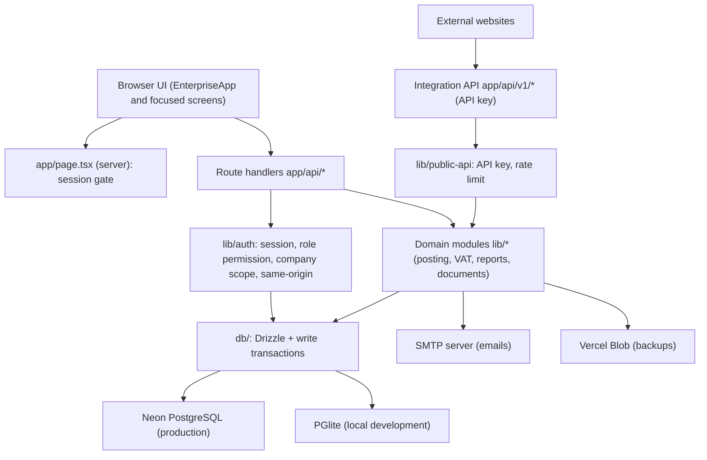
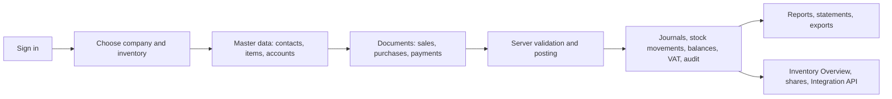

# EasyBook Online Accounting ERP

EasyBook Online Accounting ERP (formerly ComNet Enterprise Accounting) is a multi-company accounting, inventory and sales application for UAE-oriented trading businesses. One role-controlled Next.js application covers sales, purchasing, banking, inventory, VAT and corporate tax, warranty, HR, document output, reporting, and a read-only Integration API for websites.

This README is the entry point. It summarises the whole codebase — features, architecture, every API endpoint and the main workflows — and links to the focused documents in [`docs/`](docs/), which together are detailed enough that the code does not need to be re-analysed before a change.

## Contents

- [Features](#features)
- [Technology](#technology)
- [Architecture](#architecture)
- [Application workflow](#application-workflow)
- [Roles and access](#roles-and-access)
- [API endpoints](#api-endpoints)
- [Getting started](#getting-started)
- [Environment variables](#environment-variables)
- [Commands](#commands)
- [Database changes](#database-changes)
- [Quality and deployment](#quality-and-deployment)
- [Documentation map](#documentation-map)

## Features

Full detail: [docs/FEATURES.md](docs/FEATURES.md).

**Companies and workspace**
- Multiple independent companies (home currency, TRN, address, bank accounts per currency) and multiple inventories per company with their own invoice series (`C{COMPANY}-{PREFIX}-INV-{NUMBER}`).
- Per-user company assignment; company and inventory selectors scope every list, form, report, number series and stock figure.
- Branded login page per company, company document templates, a drag-and-drop **document layout builder** (bilingual English/Arabic), A4 letterheads, movable company/bank/status stamps, light/dark mode and accent colours.
- Header tools: UAE clock, calculator, online users, Ctrl/Cmd+K shortcuts, global search highlighting, Escape-to-close with unsaved-change protection.

**Sales and customers**
- Estimates, quotations, proforma invoices, sales orders, invoices, pending invoices, sales receipts, credit memos/refunds, statement and finance charges, customer payments with allocations, statements.
- Quote/order → invoice conversion with partial quantities; invoice editing; serial numbers and comments on lines; stock-return lines; delivery notes and packing lists (cartons, CBM, HS codes).
- Customer postal address and TRN printed on every sales document, delivery note, payment receipt and statement; customer ownership by sales rep; duplicate-customer detection.
- Sales rep **daily work** and an accounting handoff; restricted Sales role workspace.

**Purchasing and vendors**
- Purchase orders, item receipts, received-item bills, bills, expenses, vendor credits and purchase returns, bill payments, UAE bank cheque printing, supplier bank details.
- PO receiving with partial quantities; import bills of entry and airway bills; reverse-charge (RCM) declarations.

**Inventory**
- Items with SKU/item number, category (with colours), specifications, Product Customization Details, part/serial/UPC, HS code, country of origin, dimensions/weight, reorder points, GL accounts and VAT codes.
- **Inventory Overview**: consolidated stock across companies and inventories with filters, coloured category groups, activity tabs (Incoming, New Arrival, Price Change, Just Sold, **Today Offer**), stock holds for sales reps, and a one-line share bar (WhatsApp/Telegram with logos and emoji styles, email, editor with WhatsApp- and Telegram-style formatting, Excel with No VAT / + VAT / 0% VAT).
- **Today Offer**: time-limited offer prices with start/end, shown in the overview, shares, Excel and the Integration API.
- Transfers between inventories/companies, stock counts (inventory checks), stock pricing, revaluation, shared item catalogue across companies, serial number search, Inventory Import (CSV/XLSX), SKU edit locks.

**Accounting, VAT and tax**
- Chart of accounts with control accounts per currency, manual journals, multi-currency documents with exchange rates, automatic double-entry posting for every document, account history.
- VAT codes, VAT return periods and filing with period locks (Admin PIN override), UAE **e-invoicing (Peppol/PINT-AE) readiness**, corporate income tax working papers.

**Reports and output**
- 121 reports across Profit & Loss, Financial, Budgets, Accountant, Lists, Employees & HR, Banking, VAT, Customers, Sales, Vendors, Purchases and Inventory; memorised reports, drill-down, summaries.
- A4 print and PDF, Excel and CSV export, report stamps and bank boxes.

**HR and operations**
- Employees with salary, loans and vacation; staff salary sheets; warranty/RMA slips; shared cargo agent list; attachments on records.

**Administration and security**
- Users & access (roles, companies, activation, temporary passwords, login details, **Send email again**), **forgot password** by email, encrypted SMTP settings with **Send test email** and plain-language email errors.
- Company backups to private storage (scheduled, verified, downloadable), company data clear, audit log.
- **Integration API v1** for websites: API keys per website (Admin Controls → API & Integrations), products/stock/prices/offers/categories, change tracking, OpenAPI description. See [docs/INTEGRATION-API.md](docs/INTEGRATION-API.md).

## Technology

| Layer | Implementation |
| --- | --- |
| Web application | Next.js 16 (App Router, route handlers), React 19, TypeScript 5.9 |
| UI | Tailwind CSS 4, shadcn/Base UI and Radix primitives, Lucide icons, Recharts |
| Database | PostgreSQL (Neon serverless driver) with Drizzle ORM 0.45 |
| Local database | PGlite 0.5 with persistent files under `.local-data/` |
| Documents | jsPDF + AutoTable, ExcelJS, browser print layouts, SpreadsheetML exports |
| Email | Nodemailer with AES-256-GCM encrypted SMTP credentials |
| Storage | Vercel Blob (private) for company backups |
| Deployment | Vercel, gated by GitHub Actions (validation + CodeQL) |
| Runtime | Node.js 22.13 or newer |

## Architecture

Full detail: [docs/ARCHITECTURE.md](docs/ARCHITECTURE.md). Tables: [docs/DATA-MODEL.md](docs/DATA-MODEL.md). Every file: [docs/FILE-INDEX.md](docs/FILE-INDEX.md).



**Layers**

| Layer | Location | Responsibility |
| --- | --- | --- |
| Server entry | `app/page.tsx`, `app/layout.tsx` | Resolve the session cookie and render the login screen (or reset-link form), the forced password change, or the application shell |
| Client shell | `app/enterprise-app.tsx` | Navigation, centers (customers, vendors, items, accounts, reports, company setup), record forms and cross-module state |
| Screens | `app/*.tsx`, `app/layout-builder/` | Focused features: Inventory Overview, documents and templates, reports, admin, VAT, HR |
| API | `app/api/**/route.ts` (56 routes) | JSON endpoints; every handler checks identity, permission, company scope and same-origin for writes |
| Domain | `lib/*.ts`, `lib/layout/` | Business rules, posting, VAT, reports, exports, permissions, email, backups, Integration API |
| Data | `db/schema.ts`, `db/index.ts`, `drizzle/*.sql` | Drizzle schema, serializable write transactions, 108 SQL migrations |

**Request lifecycle (internal API)**
1. The browser sends a JSON request with the `comnet_session` cookie (HttpOnly, Secure, SameSite=Strict, 12 h).
2. `requireApiUser` / `requireCompanyAccess` verify the session, reject temporary-password users, apply the role's permission and the Sales route boundary, check company access, and require a same-origin `Origin` for writes. Deletes are limited to Administrators (Inventory Managers may delete items).
3. Inputs are validated; writes run in a serializable `withWriteTransaction` (rolled back when the response is not OK), with optional `Idempotency-Key` replay protection and SKU edit locks for stock-sensitive forms.
4. Posting documents write transactions, lines, journal entries, allocations, inventory movements, contact/account balances and audit rows together.
5. Filed VAT/tax periods are locked; a change inside one returns `PERIOD_LOCKED` and the client asks for the Admin PIN.

**Integration API** (`/api/v1`): read-only, one company per API key, keys stored as digests, 120 requests/min per key, `updated_since` change tracking through the `trg_items_updated_at` database trigger. See [docs/INTEGRATION-API.md](docs/INTEGRATION-API.md).

**Security summary**: scrypt passwords and PINs; hashed session, reset and API tokens; 5 failed logins lock an account for 15 minutes; database-backed rate limits; encrypted SMTP password; CSP and frame/no-sniff headers (`next.config.ts`); CodeQL `security-extended` must pass before deployment.

## Application workflow

Full detail with diagrams: [docs/WORKFLOWS.md](docs/WORKFLOWS.md).



1. **Sign in.** Email and password (or **Forgot password?** → emailed one-use link, 30 minutes). Temporary passwords must be changed first; changing a password signs the user out everywhere.
2. **Scope.** The user picks a company and optionally an inventory; every request carries them and the server re-checks access.
3. **Master data.** Customers (with address and TRN), vendors (with bank details), employees, items (category, specifications, prices, VAT, GL accounts) and accounts are maintained in their centers through `/api/records`.
4. **Documents.** Sales flow: quotation/estimate/proforma/order → invoice → customer payment → statement. Purchase flow: purchase order → item receipt/bill → bill payment/cheque. Credits, returns, transfers and stock counts follow the same pattern.
5. **Posting.** The server validates permissions, company ownership, VAT, exchange rate, totals, source allocations and stock rules, then writes the document, journal, stock movements, allocations, balances and audit in one transaction.
6. **Output.** Documents print or save as A4 PDF using the company template or layout builder design, with address/TRN, stamps, bank boxes and letterhead; products are shared to WhatsApp/Telegram/email or exported to Excel.
7. **Reporting.** 121 reports read the ledger, documents, contacts, stock, VAT and audit data with filters, drill-down, memorised views and PDF/Excel/CSV export.
8. **Administration.** Users, roles and companies; email server; backups; period locks and PINs; API keys for websites.
9. **Websites.** External sites read products, stock, prices and Today Offers through the Integration API and sync changes with `updated_since`.

## Roles and access

| Role | Typical access |
| --- | --- |
| `all_admin` | Everything in every company; the only role that manages Administrators, users spanning several companies and the email server. Shown as Administrator in the client |
| `admin` | Full access for assigned companies, including users with non-administrator roles in those companies, API keys, backups and company setup |
| `accountant` | Sales, purchases, banking, journals, accounts, VAT, tax, reports, pending invoices, stock holds, document stamp/bank settings; no deletion |
| `sales` | Own customers and balances, daily work, quotations/estimates, sales orders, proforma with accounting handoff, read-only Inventory Overview (no suppliers, costs or purchase documents) |
| `purchasing` | Purchases, vendors, cheques, and read-only inventory context |
| `inventory` | Items (including delete), Today Offers, category colours, logistics, stock checks, transfers, packing lists, cargo list, serial search, purchase orders, vendors, limited invoice edits (serials, comments, stock returns), warranty slips |
| `customization` | Product Customization Details plus read-only workspace and inventory |
| `viewer` | Dashboard, inventory views, serial search, stock checks and reports |

Permissions are named (`workspace:read`, `inventory:read`, `inventory:manage`, `inventory:transfer`, `customization:manage`, `reports:read`, `sales:write`, `purchases:write`, `banking:write`, `accounting:manage`, `customers:manage`, `vendors:manage`) and always narrowed by company assignment except for `all_admin`. Source: `lib/auth.ts` (mirrored for tests in `lib/access.ts`). See [Architecture: Security model](docs/ARCHITECTURE.md#security-model).

## API endpoints

56 route handlers under `app/api/`. All internal endpoints use the session cookie, return JSON, and require a same-origin request for writes. Methods, authorization and inputs for each are in [docs/API.md](docs/API.md); the external Integration API is in [docs/INTEGRATION-API.md](docs/INTEGRATION-API.md).

**Identity and administration**

| Endpoint | Methods | Access | Purpose |
| --- | --- | --- | --- |
| `/api/auth/session` | GET, POST, PATCH, DELETE | Public sign-in; signed-in user | Current session, sign in, change password, sign out |
| `/api/auth/password-reset` | POST, PATCH | Public, same-origin | Forgot password: email a one-use link; set a new password from it |
| `/api/auth/activity` | POST | Signed-in user | Record activity for automatic sign-out when idle |
| `/api/admin-users` | GET, POST, PATCH, DELETE | All-Admin, or company Administrator within scope | Users, roles, companies, status, temporary passwords, profiles |
| `/api/admin-users/resend-invitation` | POST | As above | Send the login email again with the unchanged temporary password |
| `/api/admin-settings` | GET, POST, PATCH | Company Administrator | Negative-stock override PIN, overrides, share-emoji switch |
| `/api/email-settings` | GET, PATCH, POST | All-Admin | SMTP settings and connection test |
| `/api/email-settings/test-email` | POST | All-Admin | Send a real test email to yourself |
| `/api/api-keys` | GET, POST, PATCH | Company Administrator | Integration API keys: list, create (shown once), revoke |
| `/api/user-preferences` | PATCH | Signed-in user | Appearance, accent colour, share emoji styles |
| `/api/online-users` | POST | Signed-in user | Presence heartbeat and online user list |
| `/api/admin-backups` | GET, POST | Company Administrator | Backup history, manual backup, schedule, download, verify |
| `/api/admin-backups/run` | POST | Scheduled worker (OIDC) | Run due scheduled backups |

**Company configuration**

| Endpoint | Methods | Access | Purpose |
| --- | --- | --- | --- |
| `/api/workspaces` | GET, POST, PATCH, DELETE | `workspace:read`; Administrator for writes | Companies and inventories with branding and invoice series |
| `/api/company-setup` | GET, PATCH | `workspace:read`; writes by role | Company identity, document design, layouts, stamps, bank, e-invoicing |
| `/api/company-setup/branding` | PATCH | Administrator | Login branding and logos |
| `/api/company-setup/letterhead` | PATCH | Administrator | Letterhead templates |
| `/api/company-setup/clear` | POST | Administrator + password | Clear selected company data |
| `/api/login-branding` | GET | Public | Safe login-page branding for a company |
| `/api/vat-codes` | GET, POST, PATCH, DELETE | Company access; Administrator for writes | VAT codes |
| `/api/exchange-rates` | GET, POST, PATCH | `workspace:read`; Administrator for writes | Currency rates |
| `/api/payment-terms` | GET, POST, PATCH, DELETE | `sales:write` | Payment terms |
| `/api/spec-options` | GET, POST, PATCH, DELETE | `inventory:read`; `inventory:manage` for writes | Categories, specification names and values (+ category colours) |
| `/api/category-colors` | PUT | `inventory:manage` | Category colour for Inventory Overview, item list and Excel |

**Records and accounting**

| Endpoint | Methods | Access | Purpose |
| --- | --- | --- | --- |
| `/api/records` | GET, POST, PATCH, DELETE | Permission by record kind and document type | Contacts, items, accounts and every transaction type; posting, conversion, editing, voiding |
| `/api/journal-entries` | GET, POST, PATCH, DELETE | `accounting:manage` | Manual journals |
| `/api/account-history` | GET | `accounting:manage` | Account transaction history |
| `/api/attachments` | GET, POST, DELETE | Company `workspace:read` | Files attached to records |
| `/api/sales-work` | GET, PATCH | Company access; Administrator for PATCH | Sales rep daily work; assign customer sales owner |
| `/api/employee-loan-links` | GET, PATCH | Company Administrator | Link loans/advances to employees |
| `/api/staff-salary-sheets` | GET, POST, PATCH, DELETE | Company Administrator | Staff salary sheets |

**Inventory**

| Endpoint | Methods | Access | Purpose |
| --- | --- | --- | --- |
| `/api/inventory-overview` | GET | `inventory:read` | Consolidated stock, activity, holds, offers, colours, share settings |
| `/api/item-offers` | POST, PATCH | Administrator or Inventory Manager | Create or end Today Offers |
| `/api/stock-holds` | GET, PATCH, POST | `inventory:read`; Administrator/accountant for writes | Stock reserved for sales reps |
| `/api/out-of-stock` | GET | `inventory:read` | Out-of-stock and reorder view |
| `/api/serial-search` | GET | `workspace:read` | Serial number history |
| `/api/item-customization` | GET, PATCH | `inventory:read`; `customization:manage` | Product Customization Details |
| `/api/item-logistics` | GET, PATCH | `inventory:read`; `inventory:manage` | HS code, origin, dimensions |
| `/api/item-logistics-options` | GET, POST, PATCH, DELETE | Company access | HS code / origin choice lists |
| `/api/inventory-check-reports` | GET, POST, PATCH, DELETE | `inventory:read`; Administrator to edit/delete | Stock counts |
| `/api/stock-pricing` | GET, PATCH | `inventory:read`; role-checked writes | Bulk sales/GRN prices |
| `/api/stock-revaluation` | GET, POST | `inventory:read`; role-checked writes | Cost revaluation |
| `/api/transfers` | GET, POST, PATCH, DELETE | `inventory:read`; `inventory:transfer` | Stock transfers |
| `/api/shared-items` | GET, POST | `inventory:read`; `inventory:manage` | Shared catalogue across companies |
| `/api/sku-locks` | POST, DELETE | Signed-in user | SKU edit reservations |
| `/api/cargos` | GET, POST, PATCH, DELETE | Company access | Shared cargo agent list |

**Documents**

| Endpoint | Methods | Access | Purpose |
| --- | --- | --- | --- |
| `/api/packing-lists` | GET, POST, PATCH | `inventory:read`; sales/inventory writes | Invoice packing lists |
| `/api/warranty-slips` | GET, POST, PATCH, DELETE | `workspace:read`; `sales:write`; Administrator delete | Warranty/RMA slips |
| `/api/rcm-declarations` | GET, POST, PATCH | `workspace:read`; `purchases:write` | Reverse-charge declarations |

**Reports, VAT and tax**

| Endpoint | Methods | Access | Purpose |
| --- | --- | --- | --- |
| `/api/reports` | GET | `reports:read` (some operational permissions) | All 121 report models, statements |
| `/api/memorised-reports` | GET, POST, DELETE | `reports:read` | Saved report views |
| `/api/vat-management` | GET, POST | `reports:read`; `accounting:manage` | VAT return periods and filing |
| `/api/income-tax` | GET, POST | `reports:read` | Corporate income tax working papers |

**Integration API v1 (external websites, API key)**

| Endpoint | Methods | Access | Purpose |
| --- | --- | --- | --- |
| `/api/v1/products` | GET | API key | Products with stock, price, VAT flag, Today Offer; `updated_since`, filters, paging |
| `/api/v1/products/{sku}` | GET | API key | One product |
| `/api/v1/categories` | GET | API key | Categories and colours |
| `/api/v1/openapi.json` | GET | Public | OpenAPI 3.1 description |

## Getting started

### Prerequisites

- Node.js 22.13 or newer
- npm
- A PostgreSQL/Neon connection for shared development, or PGlite for isolated local development

### Install

```bash
npm ci
cp .env.example .env.local
```

For a Neon-backed environment, set `DATABASE_URL` in `.env.local`, then run:

```bash
npm run db:migrate
npm run db:seed
npm run dev
```

To initialize the first global administrator, also set `ADMIN_EMAIL` and a 12–128 character `ADMIN_PASSWORD`, then run:

```bash
node scripts/bootstrap-admin.mjs
```

The bootstrap refuses to create another global administrator when an active one already exists.

### Isolated local mode

Run the PGlite development launcher directly:

```bash
node scripts/dev-local.mjs
```

It applies migrations, creates a local global administrator on first run, stores credentials in `.local-data/login.json`, and starts Next.js on `http://localhost:3000`. Override the directory with `COMNET_LOCAL_DATA_DIR` or the port with `PORT`.

## Environment variables

| Variable | Required | Purpose |
| --- | --- | --- |
| `DATABASE_URL` | Production/shared development | PostgreSQL connection used by the application and migration scripts |
| `NEXT_PUBLIC_APP_URL` | Recommended | Canonical application URL used in invitation, password-reset links and the OpenAPI server URL |
| `SMTP_ENCRYPTION_KEY` | Recommended for email | At least 32 random characters used to encrypt the stored SMTP password; the database URL is a fallback |
| `BLOB_READ_WRITE_TOKEN` | Company backups | Server-only token for a private Vercel Blob store |
| `DATABASE_URL_UNPOOLED` | Migration generation only | Preferred direct URL for Drizzle Kit when available |
| `ADMIN_EMAIL` | Bootstrap only | Initial global administrator email |
| `ADMIN_PASSWORD` | Bootstrap only | Initial 12–128 character temporary password |
| `COMNET_LOCAL_DB` | Local launcher sets it | Enables PGlite only in development |
| `COMNET_LOCAL_DATA_DIR` | Optional | PGlite and local credential directory; defaults to `.local-data` |
| `PORT` | Optional | Local launcher port; defaults to `3000` |
| `CI_GITHUB_TOKEN` or `GITHUB_TOKEN` | Optional deploy gate | Lets a Vercel build inspect GitHub Actions for a private repository |

## Commands

| Command | Purpose |
| --- | --- |
| `npm run dev` | Start Next.js development mode using the configured database |
| `node scripts/dev-local.mjs` | Start isolated local development with PGlite |
| `npm run lint` | Lint the complete source with zero warnings allowed |
| `npm test` | Run the release-gate, security, transaction, pricing, currency, report, document, backup and layout tests |
| `npm run typecheck` | Run strict TypeScript checks without emitting files |
| `npm run build:ci` | Build without production migration or deployment gating |
| `npm run ci` | Run lint, tests, type checking, and the CI build |
| `npm run db:generate` | Generate a Drizzle migration from schema changes |
| `npm run db:migrate` | Apply pending SQL migrations from `drizzle/` |
| `npm run db:seed` | Seed the default company, inventory, and 14 standard accounts |
| `npm run build` | Production path: verify CI, apply migrations, and build Next.js |
| `npm start` | Serve a completed Next.js build |
| `node scripts/remove-imported-items.mjs --file <csv> --company <name or id> [--apply]` | Remove items an Inventory Import created from that file; dry run unless `--apply`, keeps items edited since or used on documents |
| `node scripts/reset-duplicate-item-costs.mjs [--company <name or id>] [--apply]` | Reset Cost to 0 on items made with Duplicate item before duplicates started at 0; dry run unless `--apply` |
| `node scripts/fix-invoice-cost-of-sales.mjs [--company <name or id>] [--invoice <number>] [--apply]` | Correct the cost of sales on posted invoices/sales receipts to the average purchase cost on or before the invoice date; dry run unless `--apply` |
| `node scripts/verify-backup.mjs <file>` | Offline integrity check of a downloaded company backup |

## Database changes

`db/schema.ts` is the typed schema; hand-reviewed SQL migrations live in `drizzle/` (`0000`–`0107`) and are applied in filename order. The shared migration runner records completed files in `__comnet_migrations`. Every table, its purpose and the change checklist are in [docs/DATA-MODEL.md](docs/DATA-MODEL.md).

## Quality and deployment

GitHub Actions runs on every push, pull request to `main`, a weekly schedule, and manual dispatch. The two required jobs are:

- **Full source validation:** locked install, lint, tests, type check, and `build:ci`.
- **CodeQL security analysis:** JavaScript/TypeScript `security-extended` analysis; any finding blocks release (`scripts/check-codeql.mjs`).

Vercel installs with `npm ci --ignore-scripts` and runs `npm run build`. The production build waits until both required jobs succeed for the exact commit (`scripts/require-ci.mjs`), applies pending migrations, and then builds the application. Changes ship as one pull request per change into `main`. See [CI/CD](docs/ci-cd.md).

## Documentation map

| Document | Use it for |
| --- | --- |
| [Documentation index](docs/README.md) | Which documents are canonical and the update rules |
| [Architecture](docs/ARCHITECTURE.md) | Runtime layers, security model, transactions, concurrency and deployment |
| [Data model](docs/DATA-MODEL.md) | Every table, columns, relationships, triggers and migration checklist |
| [API reference](docs/API.md) | Every endpoint: methods, authorization, inputs and behaviour |
| [Integration API guide](docs/INTEGRATION-API.md) | Connecting Shopify, WordPress or any website: keys, endpoints, sync, examples |
| [Features](docs/FEATURES.md) | Complete product capability map and role visibility |
| [Application workflows](docs/WORKFLOWS.md) | Sign-in, posting, sales, purchasing, inventory, reports, administration and release |
| [Codebase map](docs/CODEBASE-MAP.md) | Source areas, where to make common changes, conventions |
| [File index](docs/FILE-INDEX.md) | One line per source file: what it owns and which routes it calls |
| [Company backups](docs/BACKUPS.md) | Backup schedules, archives, verification and recovery |

When behaviour changes, update the affected document in the same change. `README.md` and the documents above are the maintained source of truth; `docs/codebase-review.md`, `docs/financial-report-audit.md` and `docs/runtime-review.md` are historical audit snapshots.
