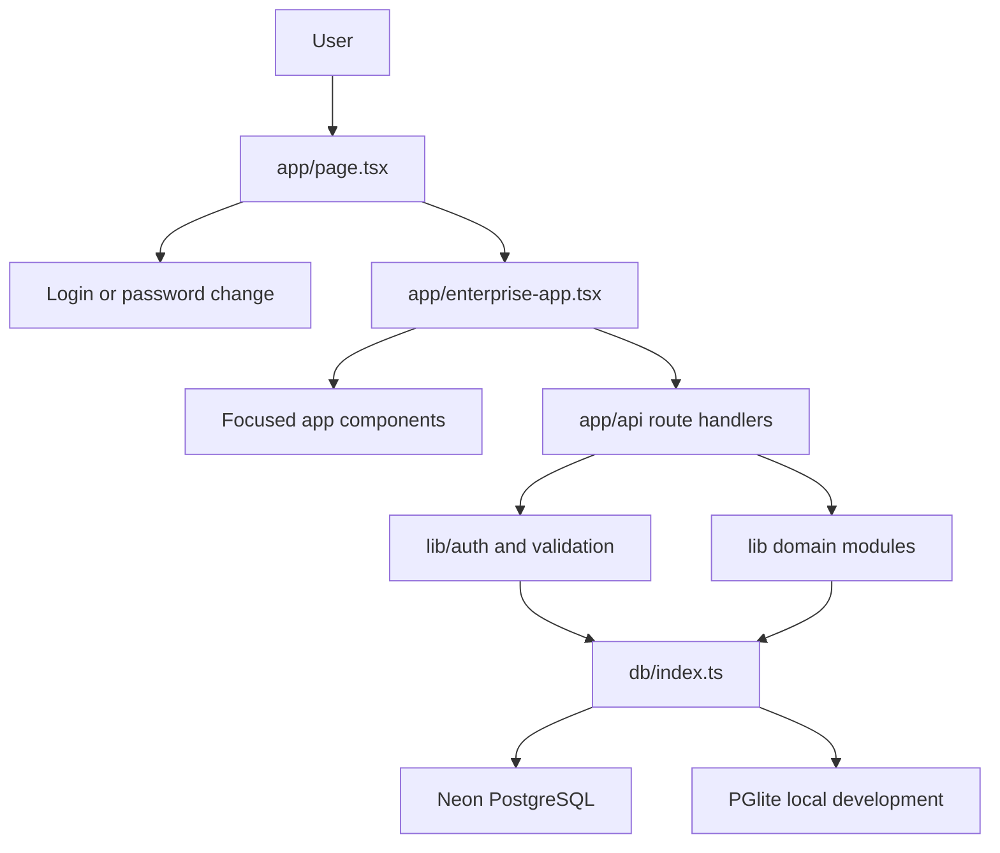
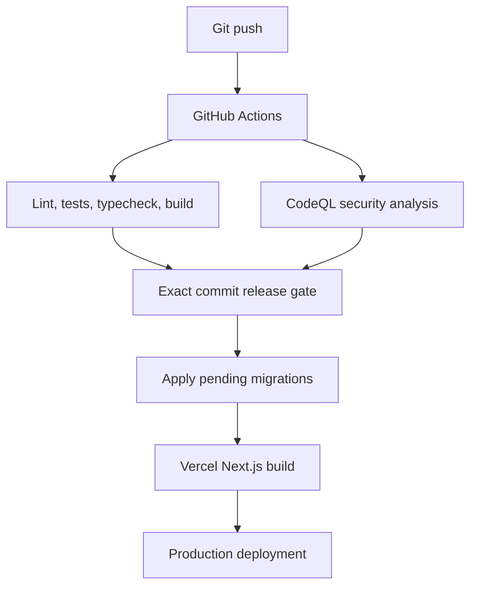

# Architecture

## System shape

EasyBook Online Accounting ERP (formerly ComNet Enterprise Accounting) is a full-stack Next.js 16 App Router application. The browser renders a single operational workspace while server route handlers provide the internal JSON API. PostgreSQL is the system of record. Domain calculations, export builders, access checks, and validation live in shared TypeScript modules.

## Runtime layers

### Server entry and application shell

- `app/layout.tsx` provides the root HTML layout and global styling.
- `app/page.tsx` is dynamic because output depends on the session cookie. It chooses among `LoginScreen`, `PasswordChangeScreen`, and `EnterpriseApp`.
- `app/enterprise-app.tsx` is the main client shell. It owns the selected view, company, inventory location, data loading, dialogs, transaction forms, document previews, report navigation, and role-visible sidebar.
- Focused components in `app/*.tsx` implement stock pricing, transfers, warranty, VAT, journals, report layouts, document templates, attachments, and other large surfaces.
- Reusable primitives in `components/ui/` provide the common design system.

### Internal API

Route handlers under `app/api/**/route.ts` return JSON or attachment bytes. They are called by the application UI and are not exposed as a stable, versioned third-party contract.

A typical handler performs these steps:

1. Resolve the session from the `comnet_session` cookie.
2. Reject password-change-required sessions.
3. Enforce a named permission or administrator role.
4. For writes, enforce same-origin requests.
5. Validate `companyId` against the user’s company assignments.
6. Validate request values and referenced company/location records.
7. Execute reads or a transactional write.
8. Return JSON with `Cache-Control: no-store` where current financial data must not be cached.

See [API reference](API.md).

### Domain modules

`lib/` contains code that can be reused by routes and UI components:

- Authentication, access, validation, errors, rate limiting, and encrypted SMTP settings.
- Invoice pricing, payment terms, contact currency, account linking, and standard accounts.
- Profit & Loss, financial, customer, vendor, employee, sales, purchasing, inventory, banking, accountant, list, and budget report transforms.
- PDF, spreadsheet, CSV, printing, letterhead, document design, and UAE cheque layout helpers.
- SKU reservations, item specifications, stock pricing, attachments, and warranty status.

Modules under `lib/` should remain deterministic where possible. Database reads and writes belong in route handlers or narrowly scoped server-only helpers.

### UI design system and responsive contract

- Tailwind CSS 4 tokens in `app/globals.css` define the shared light/dark surfaces, user accent colors, typography, focus treatment, density, responsive breakpoints, and reduced-motion behavior.
- Source-owned shadcn primitives in `components/ui/` are the default controls for buttons, inputs, selects, cards, dialogs, tables, sheets, menus, and other reusable interactions.
- `EnterpriseApp` composes the shared responsive shell: a collapsible desktop sidebar, mobile sheet navigation, sticky page header, company and inventory context, and a constrained content workspace.
- Existing feature screens inherit the shared design system instead of carrying independent page themes. Focused screen styles remain appropriate for domain-specific tables, forms, reports, and document previews.
- Screen-only presentation rules are isolated with `@media screen`; A4 reports, sales documents, letterheads, packing lists, and UAE cheque geometry remain controlled by their dedicated print rules.
- Application dialogs use a wide landscape workspace on desktop and collapse responsively on smaller screens. Printed documents default to A4 portrait, Packing Lists default to A4 landscape, and print/PDF controls expose an explicit Portrait or Landscape override without changing saved business data.
- Shared shadcn dialog content owns non-destructive minimize and maximize/restore state. Transaction editors opt into the wide desktop sizing contract through `data-record-kind="transactions"`; mobile sizing remains viewport-bound.
- Responsive behavior targets phone, tablet, laptop, and wide desktop layouts. Tables remain horizontally inspectable where the business columns cannot safely collapse, while forms and action groups reflow to one column on small screens.

## Database architecture

### Connection modes

`db/index.ts` selects the data adapter:

- **Normal mode:** Neon HTTP with Drizzle for regular reads.
- **Write transaction:** a single-connection Neon pool with a serializable Drizzle transaction.
- **Local development:** PGlite when `NODE_ENV=development` and `COMNET_LOCAL_DB=1`.

`AsyncLocalStorage` carries the active transaction so nested helpers that call `getDb()` remain on the same connection and transaction. A non-success HTTP response from work inside `withWriteTransaction` triggers rollback as well as a thrown error.

### Data domains

Every table with its key columns, relationships, triggers and backup inclusion is listed in [DATA-MODEL.md](DATA-MODEL.md).

The current Drizzle schema contains 32 tables.

| Domain | Tables |
| --- | --- |
| Company and configuration | `companies`, `company_settings`, `inventory_locations`, `vat_codes`, `exchange_rates`, `email_settings` |
| Identity | `app_users`, `auth_sessions` plus the migration-managed `app_user_companies` assignment table |
| Master data | `contacts`, `items`, `specification_options`, `accounts` |
| Transactions | `transactions`, `transaction_lines`, `invoice_payment_allocations`, `bill_payment_allocations`, `purchase_receipt_allocations`, `sales_invoice_allocations` |
| Inventory | `inventory_movements`, `stock_transfers`, `inventory_check_reports`, `inventory_check_lines`, `sku_work_locks` |
| Accounting and tax | `journal_entries`, `journal_lines`, `vat_adjustments`, `vat_returns`, `audit_log` |
| Documents and reports | `packing_lists`, `packing_list_lines`, `warranty_slips`, `memorised_reports` |

Four infrastructure tables are created by migrations and accessed with parameterized SQL rather than mapped in `db/schema.ts`: `app_user_companies`, `auth_rate_limits`, `idempotency_requests`, and `record_attachments`.

`db/schema.ts` is the typed schema definition. SQL migrations are stored in `drizzle/` and applied in sorted filename order. `scripts/migrate.mjs` records applied filenames in `__comnet_migrations`. The local PGlite launcher wraps each migration file in a transaction; the shared migration runner executes its statement breakpoints sequentially and records the migration after all statements succeed.

### Posting model

`transactions` and `transaction_lines` represent customer, vendor, and banking documents. Source and allocation fields preserve links between estimates/orders and invoices, purchase orders and receipts, invoices and customer payments, and bills and vendor payments.

Posting documents can produce:

- A balanced `journal_entries` header with `journal_lines` debit and credit rows.
  Each journal line stores the account name and the Chart of Accounts ID it posts to (`journal_lines.account_id`, migration 0090). Manual journals, stock revaluation and VAT adjustments pass the ID explicitly. For every other insert, the `journal_lines_fill_account_id` trigger resolves it with `comnet_journal_line_account_id`. The rule is: the unique active account with that name; else a unique name; else receivable/payable/bank/card accounts in the entry currency; else the home-currency account; else the entry-currency account. The migration backfilled existing lines with the same rule. Lines it could not resolve unambiguously stay `NULL`, and reports fall back to name matching (with review warnings) for those lines only. Reports (`app/api/reports/route.ts`, `lib/financial-reports.ts`, `lib/profit-loss.ts`, `lib/customer-open-balance.ts`, `lib/income-tax-data.ts`, `lib/purchase-report.ts`) and account history link by the saved ID first. Account renames update only that account's lines.
- `inventory_movements` for stock additions, reductions, reversals, or transfers.
- Allocation rows for partial receipts, partial invoicing, and multi-document payments.
- Updated contact and document balances/statuses.
- `audit_log` records for sensitive changes.

Non-posting documents such as quotations, estimates, proforma invoices, sales orders, purchase orders, and cheque orders retain workflow data without affecting the ledger until converted or posted.

## Security model

### Sessions

- Passwords use scrypt with a random salt.
- Session tokens contain 32 random bytes. Only a SHA-256 digest is stored in `auth_sessions`.
- The cookie is `HttpOnly`, `Secure`, `SameSite=Strict`, scoped to `/`, and expires after 12 hours.
- Five consecutive failed attempts lock the user for 15 minutes.
- Changing a password revokes every active session for that user.
- Temporary-password users cannot call protected APIs until they change the password.
- Forgot password: `/api/auth/password-reset` emails a one-use link (`/?reset=<token>`, 32 random bytes, valid 30 minutes, at most 3 per user per hour) through the saved SMTP server. Only a SHA-256 digest is stored in `password_reset_tokens`. The request answer is the same for known and unknown emails. Using the link claims the token atomically, sets the new password, clears any lockout and the temporary-password flag, and revokes every session. The link is built from `NEXT_PUBLIC_APP_URL` when set, so a forged `Host` header cannot redirect it.

### Integration API keys

- External websites use read-only company API keys (`/api/v1`, see API.md), not sessions. Keys are 32 random bytes; only a deterministic, low-cost scrypt digest is stored, the key is shown once, and revocation is immediate.
- Requests are rate limited per key through `auth_rate_limits`; responses never include cost, purchase or supplier data.
- `items.updated_at` is maintained by a database trigger so API syncs see every change regardless of which route wrote it.

### Roles and permissions

Server roles are `all_admin`, `admin`, `accountant`, `sales`, `purchasing`, `inventory`, and `viewer`. Named permissions are:

- `workspace:read`
- `inventory:read`
- `inventory:manage`
- `inventory:transfer`
- `reports:read`
- `sales:write`
- `purchases:write`
- `banking:write`
- `accounting:manage`
- `customers:manage`
- `vendors:manage`

`all_admin` can access every company. Every other role is restricted to rows in `app_user_companies`. The client hides unavailable views for usability, while the route handlers enforce permissions and company access as the security boundary.

Employee/HR reports require Administrator access. SMTP settings (`/api/email-settings`) are restricted to `all_admin`. User administration (`/api/admin-users`) is open to `all_admin` for every user, and to company-scoped `admin` users only for users who are not `admin`/`all_admin` and whose every company assignment is one of the administrator's companies; they can assign only non-administrator roles and their own companies. `scripts/bootstrap-admin.mjs` restores an All-Admin if none is active.

### Request and browser controls

- Mutating API calls require a matching request origin.
- Data queries validate that the requested company and inventory location belong together.
- Security headers deny framing, disable MIME sniffing, restrict referrers and browser permissions, and constrain CSP frame ancestors, base URI, and form actions.
- Stored SMTP passwords are encrypted; `SMTP_ENCRYPTION_KEY` is the preferred secret.
- Attachments validate entity type, company access, edit permission, file metadata, and configured size constraints.

## Performance rules

- Aggregate in SQL, not in JavaScript: account balances are summed per account name and entry currency in the database (`/api/records?kind=accounts`), and Inventory Overview reads the latest receipt per item with one `GROUP BY`. Avoid loading every journal line, movement or audit row into a route handler.
- Avoid per-row correlated subqueries over large tables; prefer one grouped query run in parallel with the others (`Promise.all`).
- Index time-window reads on growing tables (e.g. `audit_log (entity_type, created_at)`).
- Large client tables render progressively: Inventory Overview and the Items list draw 150 rows, then load more as the user scrolls or presses **Show more**; filtering, selection, copy and export still use the full list.
- Measured on 4,000 items / 30,000 documents / 90,000 journal lines (local PGlite): accounts list 300 → 59 ms, Inventory Overview API 230 → 160 ms; production gains are larger because fewer rows cross the network from Neon.

## Concurrency and consistency

Inventory writes use `lib/sku-locks.ts`:

1. The server resolves affected SKUs and locations from server-owned records, including source documents and both transfer sides.
2. PostgreSQL advisory transaction locks reject overlapping saves.
3. Short-lived rows in `sku_work_locks` coordinate active browser forms for 120 seconds.
4. The write runs in one database transaction and releases reservations when appropriate.

The same wrapper is used by core records, pricing, revaluation, logistics, transfers, and inventory count reports. Important edits also use expected values or source allocation checks to detect stale forms. Posting logic validates stock availability and allows protected administrator override only where the company setting permits it.

## Reporting and documents

`/api/reports` dispatches report keys into specialized modules or common data sets. Company home currency is authoritative for general accounting reports. Vendor reports may accept a transaction currency, while UAE VAT reports remain company-wide instead of inventory-location scoped.

Report output is normalized as a title, description, generation time, currency, columns, rows, optional summary, chart metadata, period metadata, and drill-down context. The client renders the same model and exports it through `lib/report-export.ts` to PDF, XLSX, or CSV.

Document output combines company setup, selected template, logos, letterhead, bank details, line data, and optional draggable stamps. Bank details and the bank stamp follow the document currency through `bankForCurrency` in `lib/bank-accounts.ts`. The default account's stamp is `companies.bank_stamp_data` (migration 0087); extra currency accounts keep `stampData` inside `companies.bank_accounts`. Print CSS and PDF generation target A4 output.

## Deployment architecture

Vercel runs `npm run build`. `scripts/require-ci.mjs` verifies both named GitHub jobs for the exact commit and branch before `scripts/migrate.mjs` and `next build` run. If a linked private repository cannot be read through the anonymous GitHub API and no token is configured, the gate runs the local lint, test, and type-check suite before allowing the build.

## Architectural constraints

- Treat API routes as the server trust boundary. UI validation alone is insufficient.
- Preserve company and location filters on every tenant-owned read and write.
- Keep related accounting and inventory writes in `withWriteTransaction`.
- Use the SKU write wrapper for a workflow that can change an item, quantity, price, cost, or location relationship.
- Preserve source/allocation links when converting or partially fulfilling documents.
- Add a migration when persisted structure changes.
- Update the canonical documentation listed in [`docs/README.md`](README.md) with behavior changes.

Employee profile data on `contacts` includes monthly salary, salary expense-account ID, manual loan balance and vacation dates. These fields are validated on admin-only employee writes and removed from non-admin contact-list responses. They are informational until a separate salary cheque is posted; salary-account IDs are resolved within the active company and validated before ledger posting.

Migration `0073_employee_bank_loans.sql` adds nullable `transactions.employee_loan_contact_id` and a company/employee index. Record APIs validate this stable employee reference and block deletion of employees with linked loans. No backfill guesses employee identity from transaction names; HR payment history derives from transactions, without copying or incrementing contact balances.

Migration 0074 adds nullable `contacts.loan_account_id`. Loan-account validation lives in `employeeLoanAccount` in `lib/employee-hr.ts`; it is reused by employee profile writes and bank loan posting.

Staff salary documents persist in `staff_salary_sheets` (migration 0075), with company ownership, serialized validated data, server-captured letterhead, revision and timestamps. Company access and administrator authorization apply to all operations; row locking and revisions prevent lost edits. Snapshots preserve historical document identity. Company deletion cascades, and the authorized saved-reports clear option includes these documents.

### Document role boundaries

All saved business-record DELETE requests require `admin` or `all_admin` in the shared authentication boundary. Session logout and SKU lock release remain available to every signed-in user. Unsaved form cancellation is unaffected. Non-admin transaction writes reject cancelled/void statuses.

`lib/document-access.ts` defines document visibility, the inventory same-day edit rule and pending-invoice permissions; `lib/document-access-sql.ts` applies visibility to query results. Inventory users can read bills and item receipts at any time, but `canEditInventoryDocument` limits full edits and attachment uploads to the creation calendar day in Asia/Dubai, independently of the editable transaction date; afterwards only `purchase-serials` appends are accepted. Inventory users cannot read `inventoryHiddenTypes` (quotations, estimates, proformas, sales orders, customer payments, sales receipts, credit memos, statement and finance charges); `documentVisibility` applies the same list in SQL. Inventory invoice edits are implemented in `lib/inventory-invoice-edit.ts`. Saved warranty receipts may retain existing supplier/bill references without granting access to the original bill.

Inventory has purchasing/vendor permissions for operational entry, narrowed in the records route to bills, receipts and purchase orders. Invoice changes use the separate append-only `invoice-serials` mode with revision checking, SKU locking and audit data; it cannot alter prices, quantities, existing serial numbers, customer, or accounting. Pending invoices are accessible only to administrators and accountants and use the existing non-posting sales-document pipeline. Conversion uses source locking and unique source-conversion identity to prevent double posting.

### Sales ownership and data boundaries

Migration `0079_sales_ownership.sql` adds nullable `contacts.sales_owner_id` and `transactions.created_by_user_id`, both user foreign keys with company indexes. Existing ownership is intentionally unassigned. Sales-created customer/document IDs come from the authenticated session, never client-selected owner values. Administrators assign customer ownership through a locked, revision-checked and audited endpoint; assigned users must be active sales users in the same company.

`lib/sales-access.ts` supplies a default-deny sales route/method boundary in shared authentication. Records queries scope customers by owner; visible quotations/estimates/orders require both creator and current customer ownership. Saved proformas are excluded from reads, attachments and edits. Sales writes are restricted to non-posting document types and assigned active customers, locked during save. Inventory item/Incoming, account selector, company setup and workspace responses remove purchase costs, supplier history, bank/stamp data and company-wide balances. `/api/sales-work` separately supplies only own balances and safe creation activity metadata.

## Backup storage and scheduling

Company snapshots use the existing serializable transaction context and explicit parent/company table scopes. `company_backups` stores status/fingerprint/history; private Vercel Blob stores compressed row archives outside PostgreSQL. `backup_schedules` holds optimistic revisions, next UTC execution and leases; `backup_worker_status` exposes heartbeat. A main-branch GitHub Actions OIDC dispatcher runs every five minutes. One running row per company and unique scheduled run keys prevent duplicate concurrent archives. See [Company backups](BACKUPS.md) for scope, retention and recovery boundaries.
