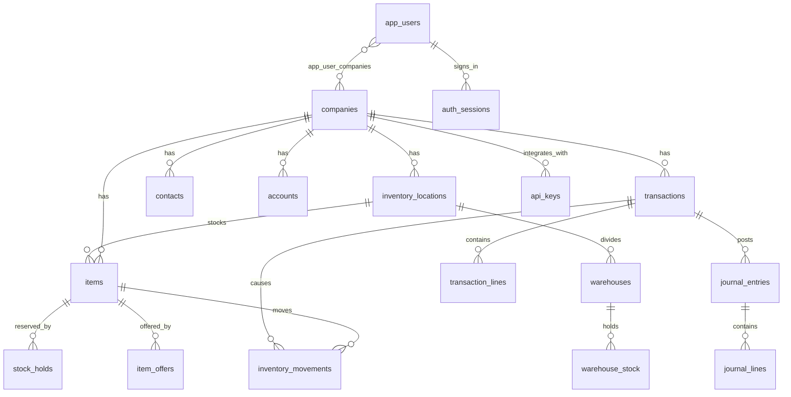

# Data model

Every PostgreSQL table, what it stores, and how tables relate. The typed schema is [`db/schema.ts`](../db/schema.ts); SQL migrations in [`drizzle/`](../drizzle/) (`0000`–`0116`) are applied in filename order by `scripts/migrate.mjs` (production) or `scripts/dev-local.mjs` (PGlite), which record each applied file in `__comnet_migrations`. Use this document instead of re-reading the schema; update it whenever a migration adds or changes a table.

## Conventions

- **Company scope.** Almost every business table has `company_id` (FK → `companies`, `ON DELETE CASCADE`). API routes always filter by a company the user may access; `all_admin` can access every company.
- **Inventory scope.** Items, transactions, journals and several reports also carry `location_id` (FK → `inventory_locations`).
- **Money.** `double precision` amounts rounded to 2 decimals in code. Foreign-currency documents store `currency`, `exchange_rate` and a home-currency `base_total`; journal lines keep `original_debit/credit` and home-currency `debit/credit`.
- **Timestamps.** `timestamp with time zone`, read as strings (e.g. `2026-10-11 13:44:28+04`); the UI and API normalise them before parsing (Safari does not accept that format).
- **Secrets.** Never stored in plain text: passwords and the negative-stock PIN use scrypt; session, password-reset tokens use SHA-256; API keys use a deterministic low-cost scrypt digest; the SMTP password is AES-256-GCM encrypted.
- **Audit.** Sensitive changes write a row to `audit_log` (`entity_type`, `entity_id`, JSON `details`).
- **Backups.** `lib/backup-snapshot.ts` lists every table included in company backups; a test fails if a new table has no include/exclude decision.

## Entity overview

## Identity, security and settings

| Table | Purpose | Key columns |
| --- | --- | --- |
| `app_users` | Users and their sign-in state | `email` (unique), `password_hash` (scrypt), `role` (`all_admin`, `admin`, `accountant`, `sales`, `purchasing`, `inventory`, `customization`, `viewer`), `active`, `must_change_password`, `failed_login_attempts`, `locked_until`, last-login IP/agent, appearance, share-emoji styles, `idle_timeout_minutes` (migration 0119; automatic sign-out after this many idle minutes, default 15, 0 = never), two-step sign-in (migration 0123): `mfa_enabled`, `mfa_secret_encrypted` / `mfa_pending_secret_encrypted` (AES-256-GCM), `mfa_backup_codes` (JSON SHA-256 digests), `mfa_last_step` (replay guard), `mfa_enabled_at`. Migration 0124 deactivated accounts with an empty `password_hash` (such as the `admin@comnet.local` row seeded by 0014) |
| `notifications` | In-app notifications, one row per recipient (migration 0113): cheque written / updated notices for post-dated cheques only (migration 0116 removed earlier notices for cheques dated on or before the notice day) for the company's active administrators and accountants plus the writer | `company_id`, `user_id`, `kind` (`cheque-written`, `cheque-updated`, `pdc-reminder`), `title`, `body`, `transaction_id` (set null on delete), `read_at`, `email_status` (`pending`, `sending`, `sent`, `failed`, `skipped`), `emailed_at`, `email_attempts` / `email_claimed_at` / `email_error` (migration 0117: failed copies retried up to 3 attempts; migration 0117 set earlier failed rows to 3 so they are not resent). `app_users.notification_emails` (default true) turns the email copies off |
| `email_templates` | Email templates for sending documents (migration 0117): each user's own, optionally shared with the company | `company_id`, `owner_user_id` (cascade), `name`, `document_type` (`any` or a transaction type), `subject`, `body` (with `{placeholders}`, `lib/email-templates.ts`), `shared`, `created_at`, `updated_at` |
| `document_emails` | Every document emailed to a customer or supplier (migration 0117) | `company_id`, `transaction_id` (set null on delete), `sent_by_user_id`, `sent_by_name`, `party`, `recipients` / `cc` (JSON arrays), `subject`, `attachment_name`, `status` (`sent`, `failed`), `error`, `provider_message_ids` (JSON array of turboSMTP API message IDs; migration 0122), `delivery_status` (last turboSMTP status: `NEW`, `DEFER`, `SUCCESS`, `OPEN`, `CLICK`, `REPORT`, `FAIL`, `SYSFAIL`, `UNSUB`, `UNKNOWN`), `delivery_detail` (JSON per-message checks with recipient and error), `delivery_checked_at`, `created_at` |
| `cheque_templates` | Unused: held company cheque templates for bank-cheque printing (migration 0114), which was removed. Rows saved before the removal are kept and still included in company backups; the table can be dropped by a later migration | `company_id`, `layout_key` (unique per company), `config` (JSON, `lib/cheque-template.ts`), `background_data`, `updated_by_name`, `updated_at` |
| `app_user_companies` *(migration only)* | Which companies a non-All-Admin user may access | `user_id`, `company_id` |
| `user_notes` | Private Company Home notes (migration 0126) | `user_id`, `company_id`, `body`, `done`, `created_at`, `updated_at` |
| `email_list_contacts` | Shared Sales and Purchase email lists for Inventory Overview emails (migration 0127; in backups) | `company_id`, `list_type` (`sales`/`purchase`), `name`, `email` (unique per owner and list on `lower(email)`, migration 0130), `created_by_user_id` (the owner: other users see only their own; administrators all), `created_at` |
| `announcements` | Company Home announcements (migration 0125) | `company_id`, `title`, `body`, `audience` (`all`, `users`), `created_by_user_id` / `created_by_name`, `ends_at`, `removed_at`; recipients for `users` in `announcement_recipients (announcement_id, user_id)`; "Got it" in `announcement_dismissals (announcement_id, user_id, dismissed_at)`; bell notices link through `notifications.announcement_id` (cascade) |
| `app_settings` | Installation settings, one row (`id` = 1, migration 0120) | `edition` (`multi_company` default, `single_company`, `single_inventory`, `single_warehouse`; rules in `lib/edition.ts`), `updated_at`, `updated_by` |
| `auth_sessions` | Sign-in sessions (12 h) | `token_hash` (SHA-256), `expires_at`, `last_seen_at` (any request, including heartbeats), `last_active_at` (migration 0119; last keyboard/mouse/touch activity, used for automatic sign-out), `ip_address` |
| `password_reset_tokens` | Forgot-password links (30 min, one use) | `token_hash`, `expires_at`, `used_at` |
| `auth_rate_limits` *(migration only)* | Shared rate-limit buckets (login, API keys) | `bucket`, `attempts`, `reset_at` |
| `api_keys` | Integration API keys, one company, read-only | `key_prefix`, `key_hash`, `scopes`, `last_used_at`, `revoked_at` |
| `email_settings` | The single email server for all companies | `provider` (`smtp` default, or `turbosmtp_api`; migration 0121), `api_region` (`global`, `eu`), host, port, `secure`, username (SMTP username or turboSMTP consumer key), `password_encrypted` (SMTP password or consumer secret), sender name/email |
| `company_settings` | Per-company admin settings | `negative_stock_pin_hash`, `share_emojis` |
| `idempotency_requests` *(migration only)* | Replay protection for retried document saves | `user_id`, `request_key`, `request_hash`, `company_id`, stored `response_body`/`response_status` |
| `audit_log` | Change history | `action`, `entity_type`, `entity_id`, `details` |

## Companies and configuration

| Table | Purpose | Key columns |
| --- | --- | --- |
| `companies` | Legal entity and its branding | name, `base_currency`, address, TRN, logos, login branding (incl. `login_logo_offset`, migration 0128; `login_top_logo_data`, `login_top_logo_hidden`, `login_logos_swapped`, migration 0129), document design/template/colour/layout, letterhead, stamps and positions, bank accounts, UAE e-invoicing setup (`einvoice_enabled`, Peppol ID, ASP, go-live), `active` |
| `inventory_locations` | Warehouses/inventories of a company | `code`, `name`, invoice prefix and number format/padding, `next_invoice_number`, `active` |
| `warehouses` | Warehouses inside an inventory (migration 0108); every inventory has exactly one default warehouse, created by the `trg_inventory_locations_default_warehouse` trigger | `location_id`, `code` (unique per inventory), `name`, `is_default`, `active` |
| `warehouse_stock` | Explicit stock per item in **non-default** warehouses only. `items.quantity` stays the inventory total; the default warehouse holds the remainder (total minus the other warehouses), so totals always agree | `warehouse_id`, `item_id` (unique pair), `quantity` |
| `warehouse_transfers` | Moves between warehouses of one inventory (migration 0110). They change only warehouse stock; `items.quantity`, cost and the ledger are unchanged, so no stock movement or journal is written | `location_id`, `item_id`, `from_warehouse_id`, `to_warehouse_id`, `quantity`, `reference`, `transfer_date`, `notes`, created by |
| `vat_codes` | VAT codes per company | `code`, `rate`, `system`, `active` |
| `exchange_rates` | Currency rates to the home currency | `currency_code`, `rate` |
| `specification_options` | Shared choice lists: item categories, specification names and values | `label` (or `__item_categories__`, `__specification_detail_names__`), `value`, `active` |
| `category_colors` | Inventory Overview colour per category (shared) | `category` (unique, upper-case), `color` (palette id) |
| `item_logistics_options` | HS code and country-of-origin choices | `type`, `value`, `label`, `hidden` |
| `memorised_reports` | Saved report views per user | `report_key`, filters, period, customer, statement date |

## Contacts and items

| Table | Purpose | Key columns |
| --- | --- | --- |
| `contacts` | Customers, vendors and employees | `type`, `name`, company/billing name, phone/WhatsApp, country, TRN, postal address (`address_line_1/2`, `city`, `region`, `postal_code`), currency, `ledger_account_id`, `balance`, vendor bank details, employee salary/loan/vacation fields, `parent_contact_id`, `sales_owner_id`, `status` |
| `items` | Products per inventory | `sku`, `item_number`, name, `category`, description, `specifications` (JSON), customization details, part/serial/UPC, HS code, origin, dimensions/weight, `quantity`, `reorder_point`, `sales_price`, `cost`, `last_purchase_price`, VAT codes, GL accounts, `status`, `updated_at` (set by the `trg_items_updated_at` trigger on every update) |
| `stock_holds` | Stock reserved for a sales rep until expiry | `item_id`, `quantity`, `sales_rep`, `expires_at`, `released_at` |
| `item_offers` | Today Offer: special price between start and end, optionally for a set quantity | `item_id`, `offer_price`, `offer_quantity` (migration 0118; null = no limit — the quantity sold is counted from non-void invoice and sales receipt lines created during the offer, `lib/item-offers-sql.ts`, and the offer is over once it is reached), `starts_at`, `ends_at`, `ended_at` |
| `sku_work_locks` | Short-lived editor locks per SKU and inventory | `lock_key`, `user_id`, `token`, `expires_at` |
| `cargos` | Shared cargo/freight agent list | name, phones, email, modes, destinations |

## Transactions and accounting

| Table | Purpose | Key columns |
| --- | --- | --- |
| `transactions` | Every document: sales, purchases, payments, cheques, expenses, journal-linked documents | `type`, `number`, `party`, `salesman`, dates, `status`, totals, VAT, `currency`/`exchange_rate`/`base_total`, links (`sales_source_id`, `purchase_order_id`, `bill_id`, `invoice_id`, `source_transaction_id`, `converted_invoice_id`), `warehouse_id` (stock documents: the warehouse they post to), delivery, void and cheque-print fields `bank_account_key` (migration 0112): the company bank account printed on a sales document — `''` follows the document currency, `default` is the main account, otherwise an extra account id from `companies.bank_accounts` `reminder_at`, `reminder_custom`, `reminded_at` (migration 0115): PDC reminder for post-dated cheques — due instant (default 7 days before the cheque date at 09:00 UAE), whether a person set it, and when it was sent |
| `transaction_lines` | Document lines | `item_id`, description, `serial_number`, `quantity`, `unit_price`, `unit_cost`, freight flag, VAT code/rate, totals |
| `record_attachments` *(migration only)* | Files attached to documents and records | `company_id`, `entity_type`, `entity_id`, `file_name`, `mime_type`, `file_data`, `file_size` |
| `invoice_payment_allocations` | Customer payment ↔ invoice amounts | `payment_id`, `invoice_id`, `amount` |
| `bill_payment_allocations` | Bill payment ↔ bill amounts | `payment_id`, `bill_id`, `amount` |
| `sales_invoice_allocations` | Order/quotation line quantities invoiced | `invoice_id`, `source_line_id`, `quantity` |
| `purchase_receipt_allocations` | Purchase-order line quantities received | `receipt_id`, `order_line_id`, `quantity` |
| `accounts` | Chart of accounts | `code`, `name`, `type`, `system_role` (AR, AP, BANK, INVENTORY, VAT…), `currency`, `parent_account_id`, `balance` |
| `journal_entries` | Posted journals (manual or from documents) | `transaction_id`, `entry_date`, `reference`, currency/rate, `posted` |
| `journal_lines` | Debit/credit lines | `account_id`, `account_name`, original and home-currency debit/credit |
| `inventory_movements` | Stock in/out per item and document | `item_id`, `transaction_id`, `movement_type`, `quantity`, `unit_cost`, `warehouse_id` (the warehouse the stock moved in or out of; migration 0109 set existing rows to their inventory's default warehouse) |
| `stock_transfers` | Transfers between inventories/companies | source and destination company/location, SKU, quantity, date |

## VAT, tax and HR

| Table | Purpose |
| --- | --- |
| `vat_adjustments` | Manual VAT adjustments per period (`direction`, `amount`, `reason`) |
| `vat_returns` | Filed VAT returns (output, input, adjustments, net due, `filed_at`) |
| `rcm_declarations` | Reverse-charge mechanism declarations (licences, signatory, stamp) |
| `income_tax_working_papers` | Corporate income tax working papers per period (`config` JSON, `revision`, `filed_at`) |
| `staff_salary_sheets` | Monthly salary sheets (`data` JSON, letterhead, `revision`) |

## Documents and operations

| Table | Purpose |
| --- | --- |
| `packing_lists`, `packing_list_lines` | Packing lists for invoices: cartons, weights, CBM, HS codes |
| `warranty_slips` | Warranty/RMA slips from customer to supplier and back, with status and stamp |
| `inventory_check_reports`, `inventory_check_lines` | Stock counts: system vs counted quantity and remarks. `inventory_check_reports.warehouse_id` (migration 0111, nullable) marks a count of one warehouse; NULL is the cross-company comparison |

## Backups

| Table | Purpose |
| --- | --- |
| `backup_schedules` | Per-company schedule (`config`, `next_run_at`, lease) |
| `company_backups` | Backup runs: status, Blob path, SHA-256, size, rows, verification, expiry |
| `backup_worker_status` | Last scheduler heartbeat |

Excluded from company backups: `notifications` (per-user), `announcements`, `announcement_recipients`, `announcement_dismissals` (per-user messages), `user_notes` (private notes), `app_settings` (EasyBook edition), `app_users`, `app_user_companies`, `auth_sessions`, `password_reset_tokens`, `api_keys`, `email_settings`, `auth_rate_limits`, `idempotency_requests`, `sku_work_locks`, `backup_schedules`, `company_backups`, `backup_worker_status`. See [Company backups](BACKUPS.md).

## Database objects beyond tables

- **Trigger** `trg_inventory_locations_default_warehouse` (function `create_default_warehouse`, migration 0108): every new inventory gets a default "Main warehouse" (`MAIN`).
- **Trigger** `trg_items_updated_at` (function `set_items_updated_at`, migration 0106): sets `items.updated_at = now()` before every update, so the Integration API's `updated_since` sees changes from every code path.
- **Performance indexes** worth knowing: `audit_log (entity_type, created_at)` (migration 0107) for Inventory Overview price changes; `transactions (company_id, transaction_date)` and `(company_id, location_id, type, status)`; `inventory_movements (item_id, movement_date)`; `journal_lines (account_name)` and `(journal_entry_id)`.
- **Unique indexes** worth knowing: `app_users.email`, `auth_sessions.token_hash`, `password_reset_tokens.token_hash`, `api_keys.key_hash`, `category_colors.category`, `specification_options (label, value)`, items `(company, location, item_number)` and `(company, location, sku)`.

## Changing the model

1. Edit `db/schema.ts`.
2. Add a hand-reviewed SQL file `drizzle/NNNN_description.sql` (next number; idempotent `IF NOT EXISTS`; statements separated by `--> statement-breakpoint`).
3. Decide backup inclusion in `lib/backup-snapshot.ts` (or the excluded list in `tests/backups.test.mjs`); a new table needs an `id` column for backup paging.
4. Update this document, and `API.md` / `FEATURES.md` if behaviour changes.
