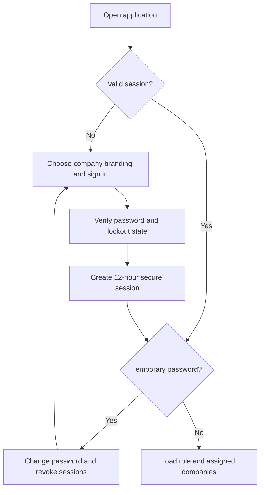
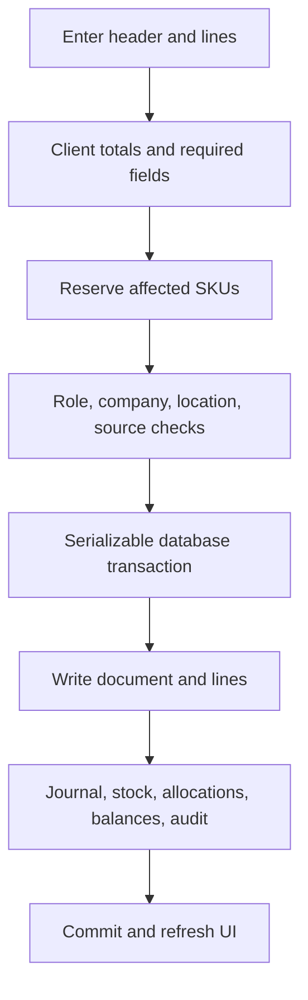
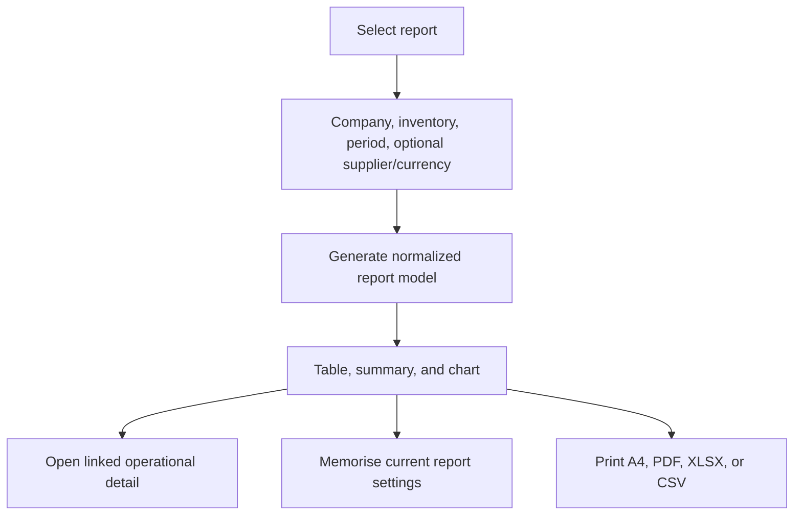

# Application workflows

## 1. Authentication and workspace entry

1. The public login screen loads safe branding, optionally for a selected company.
2. `/api/auth/session` verifies the active user and scrypt password. Five failed attempts produce a 15-minute lock.
3. Successful login records time, source IP, and user agent, then issues the session cookie.
4. A temporary-password account is sent to the password-change screen. Changing it revokes every session, requiring a new login.
5. The server loads the application shell with role, company assignments, name, avatar, and appearance mode (light or dark; the colour palette is fixed app-wide).
6. The user selects a company and inventory location. All subsequent operational calls send those identifiers, and the API verifies them again.

## 2. Master-data workflow

Customers, vendors, employees, items, and accounts use `/api/records`.

1. The client loads the selected record kind for the company and optional inventory.
2. The user creates or edits a record in the relevant center.
3. The server selects the write permission from the record kind and transaction type.
4. Company/location ownership and field rules are validated. Examples include international customer phone formats, 15-digit TRNs, vendor requirements, item types, unique SKU/item numbers, and account hierarchy rules.
5. Related records are created where required, such as currency-specific AR/AP control accounts.
6. The response refreshes the active list. Sensitive vendor changes are retained in the audit log.

## 3. Common transaction posting workflow

Posting documents share these invariants:

- The server recomputes and validates amounts instead of trusting display totals.
- Transaction currency uses a valid exchange rate and accounting effects are stored in home currency.
- Debit and credit journal lines must balance.
- Referenced contacts, items, accounts, inventories, and source documents must belong to the company.
- Stock-affecting documents reserve SKUs, lock rows, and reject stale/overlapping work.
- Negative stock is blocked unless the protected company override flow is valid.
- A failed dependent write or non-success response rolls back the transaction.

When an existing posting document is edited, the server reverses its prior ledger, stock, allocations, and balance effects before applying the replacement. Destructive deletion is Administrator-only and master data with dependent activity is protected. The delete dialog requires a written reason and offers Cancel or Delete record. The reason, authenticated user and deletion time are retained in audit history; failed deletion keeps the dialog and memo available for correction.

## 4. Sales workflow

### Quote/order to invoice

1. Create an estimate, quotation, proforma invoice, or sales order for a customer. Estimates, proforma invoices, and sales orders default the posting-account dropdown to that customer’s linked Accounts Receivable account in the document currency; invoices use the same default.
2. These source documents remain non-posting.
3. Open Sales Documents lists source lines with quantity still available to invoice.
4. Choose a source, destination inventory, and partial or full quantities.
5. Save an invoice. `sales_invoice_allocations` records each invoiced source line quantity.
6. The source status becomes partially invoiced or completed as allocations accumulate.
7. The invoice posts revenue, receivable, VAT, cost of goods sold, and stock reduction as its lines require.

### Direct sale and credit

- An invoice posts receivable and remains open until payments cover it.
- A sales receipt posts a completed sale and receipt together.
- A credit memo reverses the applicable sales and inventory effects.
- Statement and finance charges post customer balance and revenue effects without normal stock lines.

### Edit an invoice

Administrators can edit the customer, existing line quantity, unit price, VAT code, description, sales rep, due date, terms, reference, memo, comments and serials, and append new lines. Save Changes validates the current revision and updates line totals, VAT, stock, COGS, Inventory Asset, receivables and customer balances atomically. A quantity increase cannot exceed available stock, and a reduction cannot go below quantities already used by packing lists. Quantity on an invoice created from a sales source remains protected so its source allocation stays correct. Totals cannot fall below allocated payments. Customer changes require an active customer in the same company and invoice currency and no linked payments; the receivable moves to the new customer's account. Due-date or amount changes refresh open/overdue/payment status. Currency, inventory and existing item selections remain fixed.

### Customer payment

1. Select company, inventory, customer, and transaction currency.
2. The UI loads open invoices and remaining balances.
3. Allocate one payment across one or several invoices.
4. Saving creates the payment, `invoice_payment_allocations`, cash/receivable journal effect, customer balance update, and invoice status refresh.

### Sales document output

Open a saved transaction to choose its supported output: tax/commercial invoice, proforma, delivery note, packing list, or HS-code summary. Company design, logos, letterhead, bank details, VAT data, serials, line comments, attachments, and optional stamps feed the A4 print/PDF view. The output selector defaults documents to portrait and lets the user switch to landscape.

Selecting an inventory item for a new sales or purchase line fills the complete uppercase inventory description: item name, SKU, condition, and saved specifications. Customer invoice output omits the Item #; the invoice Inventory Copy and Inventory Overview share/copy text append it at the end.

### One saved design for print and PDF

In Company Setup → Invoice Template Customization, edit the selected saved template and save Company Setup. In Templates, enable **Active for all** to use one design everywhere. Selection order is the active all-document template, an active template for the document type, the latest active saved template, then the enabled root customization. Without customization, existing defaults remain available. Reopening the designer edits the selected active Invoice template instead of a disconnected root snapshot.

A4 outputs honor Print visibility separately from Screen visibility, including custom boxes, labels, typography, element properties, logos and footer text. Specialized documents retain their required body fields and financial columns inside the same customized frame. Report rows, summaries, account mapping warnings and filters remain authoritative; this change does not create journal entries or change Chart of Accounts links. Long customized reports continue across A4 pages. CSV and Excel remain structured data exports rather than visual page templates.

The shared design is connected to sales and purchase documents, credit/refund documents, delivery notes, packing lists, HS summaries, customer payment receipts, cheque vouchers, warranty/supplier receipts, RCM declarations, salary sheets, inventory checks, record lists and report exports (including journals, tax and P&L). Report print opens the same PDF layout as download. Stamp placement remains adjustable on document/report controls; packing, HS and customized salary outputs also provide a stamp placement panel. Dedicated document PDF controls suppress the duplicate generic PDF action. The letterhead designer keeps its own authoring preview.

## 5. Purchasing workflow

### Purchase order receiving

1. Create a non-posting purchase order for a vendor.
   Selecting the vendor fills the posting account from its linked Accounts Payable account in the order currency; changing the order currency refreshes that selection. If a legacy vendor has no account in that currency, the form creates or restores the currency control account before saving and links it to the vendor when appropriate.
2. Open Purchase Orders shows quantities not yet received.
3. Select an order, receiving inventory, and partial/full line quantities.
4. Save an item receipt or received-item bill.
5. `purchase_receipt_allocations` records quantities against each order line.
6. Inventory is increased; a bill also posts payable, inventory/expense, and input VAT effects.
7. Inventory Overview → Incoming links each remaining quantity to its Purchase Order. It shows whether the PO is ready to convert to a Bill or has a partial linked Bill; converted and fully received POs leave Incoming.
7. The purchase order becomes partially received or received based on cumulative allocations.
8. An administrator can reopen a linked supplier bill and edit its received quantity, price, VAT code, description, comments, serial number, freight, dates, and memo. The item remains tied to its original purchase-order line; stock, receipt allocation, VAT, payable balance, and journals are replaced atomically. Quantity cannot exceed the PO quantity remaining after other receipts, and reductions are blocked when the received stock has already been used.

### Bills and vendor payments

1. Enter a bill or expense in the vendor currency and inventory context. Bills default the posting-account dropdown to the selected vendor’s linked Accounts Payable account in that currency; purchase orders use the same vendor-currency default.
2. The posting creates payable/expense or inventory/VAT journal effects and stock additions where relevant. Stock received through Enter Bill appears in Inventory Overview → New Arrival for 12 hours from saving, regardless of the bill’s business date. View opens the original bill in its company/inventory context. Editing the bill preserves its original creation timestamp; cancelling or deleting it removes it from subsequent overview loads.
3. The unpaid-bills view calculates remaining balance from direct and multi-bill allocations.
4. A bill payment or supplier cheque can allocate one payment to multiple bills through `bill_payment_allocations`.
5. Saving updates the vendor balance and each bill’s payment status.

### Purchase return

1. Select a vendor, inventory, currency, and original bill.
2. The server calculates purchased quantity less earlier returns.
3. Create a vendor credit for an allowed quantity.
4. Posting reduces stock and payable/expense effects and links the return to its source bill.

## 6. Inventory workflows

### Item maintenance

1. Create a stock or supported non-stock/service item in an inventory location.
2. Maintain sale price, unit/GRN cost, reorder point, specification values, serial details, and status.
3. Logistics maintenance adds HS code, origin, dimensions, and weight.
4. Shared Items can compare/copy a matching SKU across companies the user can access.

### Transfer

1. Select source company/inventory and one or more items.
2. Select a destination inventory for every line and enter quantities.
3. The server verifies access to both sides, resolves source/destination SKU locks, and checks stock.
4. A transaction moves quantity out of the source and into the destination while retaining transfer history.
5. Administrator edit/delete paths revise or reverse the prior movements.

### Inventory check

1. Choose a company/inventory and select currently stocked items.
2. Save a count report with system quantity and actual quantity.
3. The report retains line snapshots and can compare the same item across accessible companies.
4. Administrator update/delete paths use SKU locks to avoid conflicting quantity work.

### Pricing and revaluation

- Stock Pricing loads current sale/GRN prices. Batch save includes expected old values and returns `409` when another update won the race.
- Stock Revaluation calculates valuation inputs and posts protected cost changes.
- The Out of Stock view filters the consolidated inventory data by selected company/location and reorder state.

## 7. Banking, journal, VAT, and cheque workflows

### Banking

Deposits, cheques, credit-card charges, account transfers, cheque orders, and opening balances use the common transaction flow. The server selects the correct system/control accounts and creates balanced journals.

### General journal

1. Select company, inventory, date, reference, currency, and exchange rate.
2. Add debit and credit lines against chart accounts.
3. The server requires a balanced entry and valid accounts.
4. Posted entries feed the ledger and financial reports. Authorized edits/deletions update the ledger consistently.

### UAE cheque

1. Choose supplier, salary, or expense purpose and a configured bank layout.
2. Enter payee, amount, date, account, memo, and optional bill allocations.
3. Save to post the banking/payable/expense effect.
4. Print through the bank-specific positioning controls, including date and crossing alignment.

### VAT

1. VAT codes drive transaction line tax calculations.
2. Selecting `Goods imported into the UAE` on a supplier bill requires a Bill of Entry No. and Airway Bill No.; supporting customs files can be attached to the same bill. In Purchases, search by Bill of Entry No. to find and open the linked supplier bill in the selected company and inventory.
3. The VAT center loads a company-wide period, independent of selected inventory.
4. Accounting users review output/input tax, reverse charge, exceptions, and unassigned activity.
5. Authorized users add adjustments and record VAT return/filing data.
6. VAT reports and the Report Center read the same posted transaction and journal sources.

## 8. Warranty and packing workflows

### Warranty/RMA

1. Choose a customer or invoice and load eligible invoice items. Selecting an item automatically fills its supplier, purchase bill, and purchase date when the serial identifies a source bill; an item-only match is used only when one purchase bill is unambiguous.
2. Optionally open Warranty / RMA directly from a saved supplier bill; the supplier, bill number, and purchase date are prefilled.
3. Record item, serial, issue, received date, supplier return dates, condition, and service status.
4. Save/update the slip and print the A4 service record. The RMA list and form can reopen the linked supplier bill.
5. Mark the item returned to its supplier, or save the Returned to Supplier status in the list. The supplier return receipt preview opens automatically; saving the return status fills a missing return date with today in UAE time. Check the return date and ensure the supplier bill, purchase date, serial number, and problem are present, then save. Print or download the receipt as A4 PDF for the supplier to acknowledge. Use the Document selector to switch between the customer warranty slip and supplier receipt; the receipt remains available after subsequent status changes when a supplier return date is recorded.

### Packing list

1. Open a sales invoice and load its lines.
2. Create a packing list number/date and edit carton references, quantities, weights, dimensions, and serials.
3. Save the packing list linked to invoice and invoice lines.
4. Print the A4 packing document through the selected company design. Packing lists default to landscape, with portrait available from the output selector.

## 9. Reporting workflow

The UI groups and searches 121 report definitions. `/api/reports` validates report-specific access and filters, loads ledger/transaction/master data, and returns normalized columns and rows plus optional summary/chart/period metadata. The client can drill into linked areas, save a user/company report view, choose A4 portrait or landscape (portrait by default), and export the same result. In Inventory reports, search or filter by asset account and status/aging, sort stock quantities or values, and optionally hide zero QOH. The summary, net totals, printed rows and downloads all follow the current filtered rows. Desktop uses a detailed table; tablet/mobile use stock cards with labeled quantities and prices. Asset-account links open the saved account history; stock valuation is a current quantity/cost snapshot, not a reconciliation to the posted ledger.

Purchases reports can be searched or filtered by supplier, payable/payment account and status. Summaries, totals, print and downloads follow the displayed rows. Bill/expense account links come from posted credit accounts; PO links show planned accounts. Open commitments subtract all current receiving allocations, including receipts saved after the selected PO date range, and exclude VAT. Use the original PO links to open receiving and the supplier links to open Vendor Center.

Sales reports support customer, representative, receivable/receipt, revenue-account and status filters. Displayed rows determine summaries, graphs and every output. Sales exclude VAT; credit memo returns are shown separately in Sales Graph. Pending Sales uses document face values, not an open AR balance or a revenue forecast. Sales-order quantities include all saved fulfilment allocations, even invoices after the selected order dates. To position a Sales stamp, enable it and drag on the A4 preview, use arrow keys (Shift for 5 mm), or edit millimetre offsets. Print and PDF use the same selected page coordinates.

For VAT reporting, select the company and period; inventory selection is ignored and outputs identify company-wide scope. Filter by saved VAT code, tax direction, posted account or code status; summaries and downloads follow the displayed rows. Code links open a filtered current register, with authorized navigation to VAT Codes or VAT Management. Credit notes reduce taxable values and VAT. Both report exception review and filing review include per-line freight in the taxable base. Missing/ambiguous posted VAT links remain review labels. VAT Position Summary excludes manual adjustments; VAT Management retains the filing review workflow. The optional VAT stamp uses the same A4 drag, keyboard and millimetre placement controls as Sales.

For Vendors, select company, inventory, currency and optionally a supplier. QuickReport and Open Balance require the selected supplier. Search and filter activity by supplier, posted account, status or document type; open-bill views also support past-due-only filtering. Summaries and exports use visible rows while running balances retain original report order. Supplier balance summaries and detail retain all prior activity through the selected as-of date. Statements use their dedicated server-side date/currency/supplier filters so opening and closing balances remain intact. Voided or cancelled supplier documents are excluded. Posted payable entries classify charges and settlements; cash-paid expenses do not increase payable balances, and bill-linked bank cheques reduce balances and statements. Verified account links open ledger history; documents and suppliers open their original areas. Move the optional stamp on the scaled A4 preview or enter millimetre offsets.

## 10. Administration workflow

- **Companies and inventories:** create/edit workspace records, bank/company metadata, currency, invoice series, and locations.
- **Users:** create users, assign roles and companies, reset temporary passwords, activate/deactivate accounts, and send invitation email when configured.
- **Branding:** configure login visuals, logos, company document template/color, letterhead, and stamp.
- **SMTP:** save encrypted mail settings and send a test message.
- **Company clear:** protected Administrator action for clearing selected operational data while retaining required setup.

## 11. Development and release workflow

1. Install the exact lockfile with `npm ci`.
2. Develop against configured PostgreSQL with `npm run dev`, or isolated PGlite with `node scripts/dev-local.mjs`.
3. Change `db/schema.ts` and generate/review a SQL migration for persistent model changes.
4. Run `npm run ci` before release-sensitive changes.
5. Push the commit. GitHub Actions runs full source validation and CodeQL.
6. Vercel begins the Git-linked build and waits for both required jobs for the exact SHA.
7. The production build applies pending migrations, builds Next.js, and deploys only after the release gate succeeds.

### Shared report output controls

Choose a category from the sidebar on desktop or the category selector on tablet/mobile, or search the full library. Verify the company/inventory context and report-specific scope before opening a report. The supplier and transaction-currency selectors are also shown when vendor reports appear in search or All Reports. Saved views are offered only for currently available report definitions.

All report categories expose the same optional company stamp preview. Enable the stamp, drag it on the A4 preview (or use arrows / millimetre inputs), then print or export PDF using the selected orientation. Report-specific account/document links and calculations remain authoritative. Shared tables use mobile cards and restore the detailed table when printing. CSV, Excel and PDF include each category summary where defined; generic running balances and unit prices are never automatically totaled.

### Employee salary and vacation setup

In Employees & HR, create or edit an employee to record monthly salary, salary expense account, manual loan balance and vacation departure/return. Saving updates the profile only. For payment, use Write Cheque → Salary and select the employee: the saved amount/account prefill, and posting debits the configured salary expense account and credits the chosen bank. Loan disbursement/repayment and vacation pay calculations are not automated by the profile fields.

To pay an employee loan, open Banking → Write Cheque, choose Employee loan, select the employee, Pay From bank and employee loan/advance asset account, then save. Posting debits that asset and credits the selected bank; HR reads the saved transactions directly. Deleting a payment through the existing authorized transaction workflow removes it from HR totals. These are disbursement totals, not repayment-adjusted loan balances; keep manually recorded amounts separate. Employee form outside clicks do not dismiss it; Minimize preserves the draft in the window dock.

In New/Edit Employee, choose Loan / advance account and save the profile before creating a Banking employee loan payment. Selecting the saved employee selects that account, and the server enforces it. If no eligible account exists, the HR form explains how to create an Other Current Asset account in Chart of Accounts. Saving the profile never posts the manual loan amount or assigns existing transactions.

In Employees & HR, open Salary sheets, create a monthly sheet, choose the period and company code, select HR employees or enter manual rows, then supply the personal/card/bank/IBAN details and salaries. Enter charges or use count × fee as a starting value; charges can include the service provider’s tax/other fees. Save to view, edit, delete, Print A4 or download PDF. Print opens the generated A4 landscape PDF with a print action. Assign Staff Salary Sheet in the company letterhead editor before creating a sheet to use its design. Saved sheets retain that branding. Creating a sheet is document preparation; salary payments continue through Banking.

## Pending invoice and inventory staff workflow

An administrator/accountant selects Pending Invoice in Sales, enters the customer and lines, then saves the draft. Reopening permits edits; Convert to Invoice posts through the existing sales conversion with source locking. Saving or editing the draft never changes stock or the ledger.

Inventory staff work on bills/receipts during their UAE creation day. After midnight those documents leave their lists and direct API access is denied. Purchase orders remain available independently of that bill deadline. Invoice serial additions use a dedicated append-only editor. Warranty/supplier receipts remain service records with their own saved references and print output.

### Sales representative daily work and accounting handoff

1. An admin assigns existing customers in Customer Center → Assign customer to sales user. New customers entered by a sales user are automatically assigned to them; no legacy assignment is inferred.
2. The representative opens My daily work to see their own active-customer count, balances grouped by currency and document activity by UAE creation date. My customers lists only assigned customers.
3. The rep creates a quotation, sales order or proforma for an assigned active customer. Names at least 70% similar and duplicate TRNs/contact numbers are blocked across the company.
4. Saving a proforma gives its reference and a direction to ask accounting. Sales cannot reopen, edit or export it. Accounting opens it from Sales → Proforma Invoices and generates PDF with the company bank details/stamp. No message is automatically sent.
5. Incoming lists remaining purchase-order quantities with selling prices, without supplier identities, purchase costs or purchase-document access.

Income tax: open Financial → Income Tax Working Paper, choose a complete tax period and rates, select or create tax expense/payable accounts, enter explained adjustments, and Calculate. Save working paper stores inputs for the period; opening it and recalculating uses current postings. Review warnings and provision comparison, then export/print. This workflow never creates a tax journal or submits a return. Administrators/accountants can maintain configurations; report readers can calculate and export.

## Scheduled company backup

Open Admin Controls for the company, create a manual backup, then set a start date, UAE time, repeat frequency and retention; enable and save. Confirm the next run and recent scheduler heartbeat. Download a completed file and keep its displayed fingerprint with a separate secure copy. Verify files through history or the offline `backup:verify` command. Administrators can pause schedules and explicitly delete files. Recovery requires an isolated database rehearsal and separate approval before changing live data; detailed instructions are in [Company backups](BACKUPS.md).

### Sales register review and output

Use Sales document workflow to create the appropriate source document or pending invoice. Open a saved eligible source, select inventory and available quantities, and save the partial/final invoice. The conversion view shows the original unit price/currency alongside ordered, invoiced, remaining and available quantities. Stock and accounting writes still use the existing source allocation and posting rules.

For register reporting, select document type, status, currency, dates and search. The summary and exports use the same filtered loaded records. Use Export → Print A4 preview/PDF/Excel/CSV; company and inventory headings match the active workspace. Stamp & A4 lets administrators/accountants move or hide the stamp used in print/PDF. The planned posting account on source documents is informational until posting; the Chart of Accounts shortcut is limited to roles with account access.

### Purchase workspace and register output

Select the company and receiving inventory, then create an order, receive delivered quantities, enter the supplier bill, or settle/return a bill using the role-appropriate workflow actions. Open-order selection supports one source for a bill or sequential receipts for multiple selected orders. Receiving cards show ordered, received, remaining, receive-now quantities and the original unit price/currency; partial receiving keeps outstanding quantities on the order.

Filter the purchase register by document type, order state, search, transaction dates, status and currency. Export the filtered loaded rows through Print A4 preview, PDF, CSV or Excel. Admin/accountant users can position the configured stamp with Stamp & A4. Changing the company, inventory or document list resets register filters. Purchase orders are non-posting commitments; receipt/bill/payment accounting continues through the existing linked account rules. The register displays recorded account names, not inferred mappings.

For document output, the company stamp and the bank details box start switched off unless positions were saved for that document type (classic templates and Layout Builder layouts alike). Tick **Company stamp** or **Bank details box (currency)**, then drag each anywhere on the first page or set Left / Top in mm from the top-left of the printable area. The bank box shows the Company Setup bank account for the document currency, as readable text, plus its remark (set per account in Company Setup → Bank account) and its optional bank stamp image. **Remark on this document** rewrites the remark for that document only. On payment documents (not delivery notes, packing lists or HS code summaries), **Bank account details** shows or hides the template's own bank block; it is on by default. **Save stamp positions** stores both items' on/off state and position for that document type (Tax Invoice, Quotation, Delivery Note, ...), so every document of that type opens with them; positions saved before this change (offsets below the totals) are ignored. Unsaved changes apply only to the open preview. Report stamp coordinates are preferred positions: output shifts the stamp down past the final table or onto a new page to avoid overlap. Print and PDF follow the same placement rules; the placement guide is not a full report preview.

Customer/vendor sub-accounts organize contacts independently of ledger sub-accounts. Select the parent on Add/Edit and save; invoices/bills continue posting to the individual contact and its existing AR/AP rules. Inactive contacts retain balances/history and can receive settlement payments, but new trading documents require reactivation. Parent deactivation requires resolving active children first.

### Invoice line Pending Cart

In a new invoice or administrator invoice editor, choose Pending on any positive sale line. The line moves into the draft Pending Cart section and is excluded from the current invoice items/totals. Restore puts it back before saving; Cancel discards the move. Save commits the invoice and a non-posting pending invoice together. Open Sales → Pending Cart to view/edit the saved customer draft and Convert to Invoice when ready. Company, inventory, currency, customer, quantities, prices, VAT, comments and serials are retained. Pending lines do not reserve stock.

For a posted invoice, saving reverses the moved quantities, revenue, VAT, cost, inventory and receivable effects through the existing adjustment workflow before removing the lines. The invoice cannot fall below allocated payments. Packed lines must be removed from packing lists first; source-linked invoices must be handled through their original source workflow. Stock-return lines cannot be held in Pending Cart. Moving every line of a new invoice saves only the pending draft; moving every line of a posted invoice cancels the now-empty original with a zero total and audit trail. Stale revisions and failed cart validation roll back the complete move.

### Customize the complete invoice series

In Management → Invoice series (or Edit series on an inventory), administrators can edit the complete format, prefix, minimum digit count (1–12) and next sequence (1–999999999). Include `{NUMBER}` exactly once; optional `{PREFIX}` and `{COMPANY}` insert the inventory prefix and three-digit company ID. Literal text, year, separators and suffixes can be replaced or removed, for example `COMNET/2026/{NUMBER}` or `{NUMBER}`. Year text is literal and does not roll over automatically. Presets offer INV, number-only and the original format. The live preview and invoice creation share one formatter. Existing inventory formats default to `C{COMPANY}-{PREFIX}-INV-{NUMBER}` with four digits.

Save changes only future invoices for that inventory; saved invoices retain their original numbers. The server locks the inventory sequence, rejects a stale editor if an invoice was issued or settings changed, checks for a used next number, and records the change in the audit log. Issuing an invoice checks again for collisions and rolls back its counter and posting on failure. Minimum digit count adds leading zeros and never truncates larger numbers.
